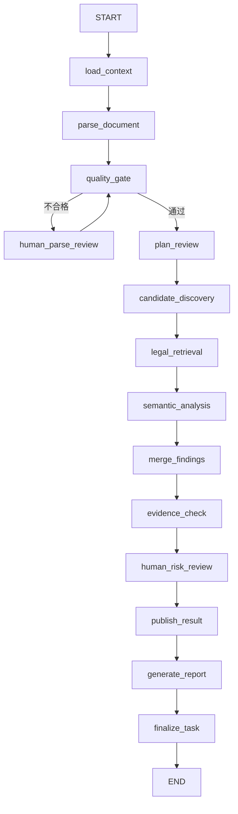

# LangGraph 状态、依赖与节点契约

基线：ADR-0005 / v1alpha2。独立能力可单测；有数据依赖的节点不得直接并行。

## 主图

## 数据依赖

`candidate_discovery` 从原文和上下文产生规则候选、语义线索与每类 Skill 的检索主题。语义线索不构成合规结论；检索覆盖既包括候选问题也包括 Skill 检查清单，不能仅检索已经命中的规则。

`legal_retrieval` 消费上述线索，按项目地区、采购类型、审查基准日和法规快照过滤。`semantic_analysis` 明确消费原文、项目上下文、候选与法规条款。检索失败或无适用依据时，模型只能输出疑似或证据不足。Evidence Checker 再执行独立校验。

解析/上下文不足时停止相关审查，不把未审查项当作“无风险”。低质量人工修正后必须回到 quality_gate；无改进时保持 waiting_human，记录原因，避免无限自动循环。

## 节点与字段归属

| 节点 | 必需输入 | 独占输出 | 失败策略 |
|---|---|---|---|
| load_context | 租户、项目、任务 ID | project_context_ref、review_snapshot_ref | 无权或关键上下文缺失时终止/等待确认 |
| parse_document | document_refs | section_index_ref、parse_quality_ref | 有限重试，资源上限 |
| quality_gate | parse_quality_ref | 路由与质量门禁记录 | 低质量转人工 |
| human_parse_review | 原文定位、低质量原因 | 更新解析引用与质量记录 | interrupt，修正后复检 |
| plan_review | 上下文、章节索引、快照 | review_plan_ref | 缺少已发布配置则失败 |
| candidate_discovery | 审查计划、原文 | discovery_ref、rule_findings_ref | 每个Skill输出覆盖/失败记录 |
| legal_retrieval | discovery_ref、快照、上下文 | retrieval_results_ref | 缺证据显式标记，不造证据 |
| semantic_analysis | 原文、候选、retrieval_results_ref | model_findings_ref | 结构错误最多2次；失败转复核 |
| merge_findings | 候选、规则、模型输出 | findings | 稳定ID去重，保留来源与冲突 |
| evidence_check | findings、原文与法规 | findings、pending_review_ids | 按证据状态降级，不覆盖人工决定 |
| human_risk_review | 证据结果、覆盖记录 | 人工决定与审计引用 | 首版发布均需审核员确认 |
| publish_result | 已复核结果、版本快照 | 不可变结果版本（对象存储/数据库） | 乐观锁与幂等键；未审查项必须可见 |
| generate_report | 已发布不可变结果版本 | report_ref | 幂等渲染；失败重试同一快照 |
| finalize_task | report_ref、已发布版本 | status 与完成事件 | 只有报告成功才标记succeeded |

State 中的 findings 只保存有界的摘要；完整候选、逐条证据和审计历史保存外部结果对象。实施时在 TASK-0009 给出 State 大小上限和超限引用策略。

## 并行与汇合

- 可以按章节、Skill并行发现候选和检索；分析必须等待所属工作单元的法规检索完成。
- 静态分支用显式多前驱汇合；动态Skill分发由调度节点分配稳定 work_item_id，并以本轮 expected/finished 集合汇合。
- 所有工作单元完成或返回可见失败记录后才能融合；不得“先返回的结果即全量结果”。
- 独立分支优先写各自的引用字段。共同集合使用按稳定ID合并的 reducer；共享 errors 也需专用reducer。禁止并行写 status 或一个未配置reducer的字段。
- 幂等键包含 tenant_id、review_task_id、run_id、work_item_id 和配置快照版本；重试不得追加重复候选。

## State 的唯一来源

`contracts/schemas/compliance-state.schema.json` 是唯一字段来源。运行 `python scripts/generate_state.py` 生成 `src/bidding_compliance/graph/state.py`。生成文件禁止手改，统一检查比较生成结果并拦截漂移。TypedDict 负责静态类型，边界处仍需 JSON Schema 校验；生成类型不表示已实现运行时验证。

Schema 中非必填字段生成 NotRequired，nullable 字段生成 `| None`；GraphError 中可选字段遵循相同规则。State 初始版本为 v1alpha2。

## Checkpoint、重试与版本

- Checkpoint 隔离键由 tenant_id、review_task_id 和 run_id 组成；恢复前重新鉴权。
- review_snapshot_ref 指向冻结的输入哈希、规则、法规、Skill、Prompt、模型profile和参数快照。恢复不得静默使用新版本。
- 网络、限流等临时错误有限重试；权限和前置条件错误不自动重试。模型Schema错误使用受限修复策略，与基础设施重试分开计数。
- 文档、上下文或版本快照发生变化时创建新run；旧Checkpoint保持可追溯，升级须明确迁移或拒绝恢复。

