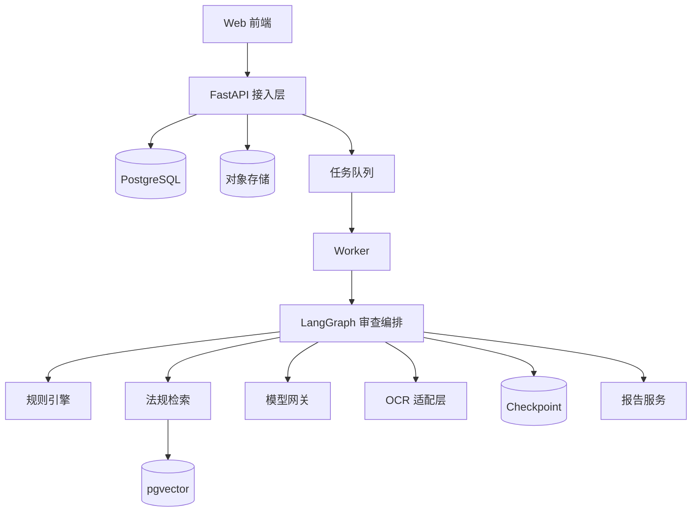

# 系统架构

## 分层

## 职责边界

| 模块 | 负责 | 不负责 |
|---|---|---|
| API | 身份、权限、参数、资源、状态查询 | 长时间 OCR 与模型推理 |
| 队列 | 调度、并发、重试、背压 | 业务分支与审查结论 |
| LangGraph | State、节点、路由、人工中断、恢复 | 直接保存大文件或供应商密钥 |
| 规则引擎 | 确定性候选风险 | 单独给出无法律证据的最终结论 |
| 检索 | 有效法规及条款证据 | 替模型作价值判断 |
| 模型网关 | 适配、路由、结构化输出、预算、日志 | 领域权限与最终结论发布 |
| Evidence Checker | 原文、法规、版本、推理强度校验 | 绕过人工复核发布高风险结论 |

## 依赖方向

领域层不依赖 FastAPI、LangGraph 或具体模型 SDK。外部系统通过端口和适配器接入。禁止从领域层导入基础设施实现。

规则、检索和模型分析虽然可独立测试，执行顺序仍受数据依赖约束：候选发现后检索，检索结果进入分析。详细流程与汇合规则见langgraph.md和ADR-0005。

